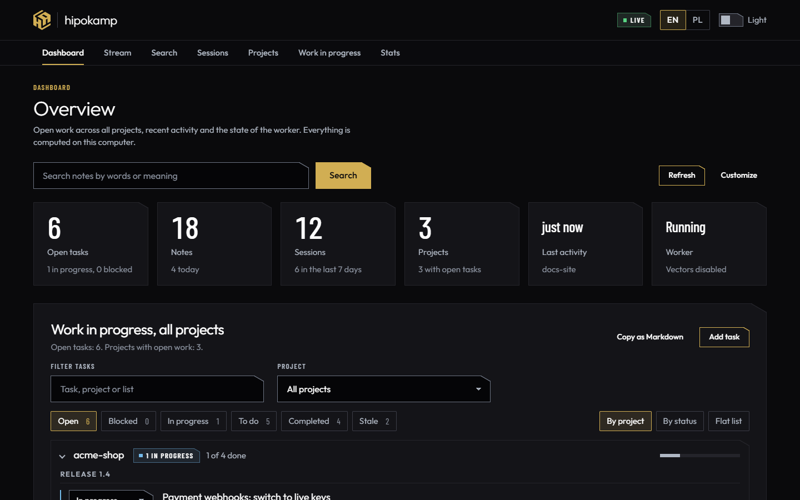
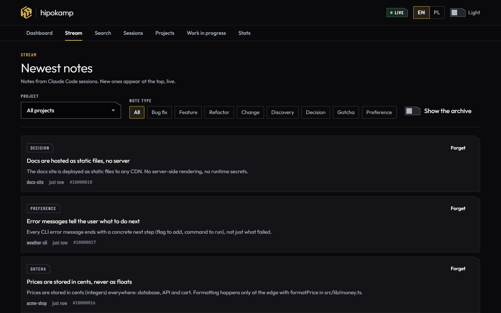
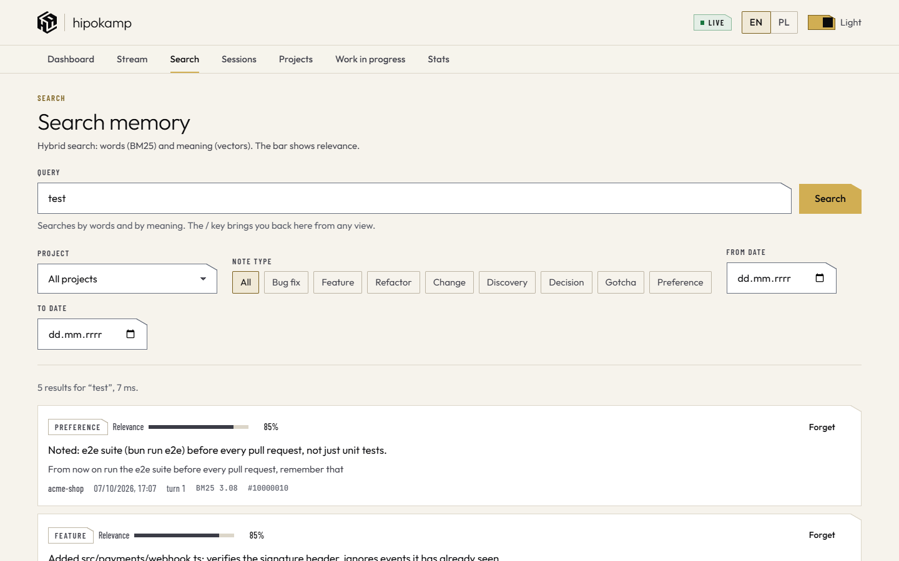
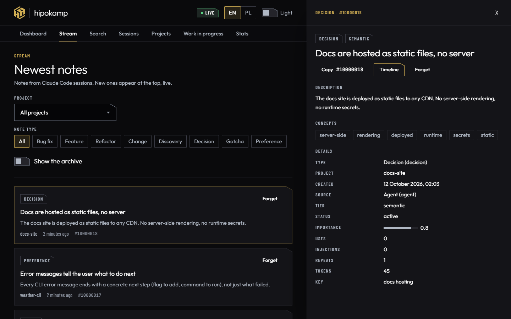
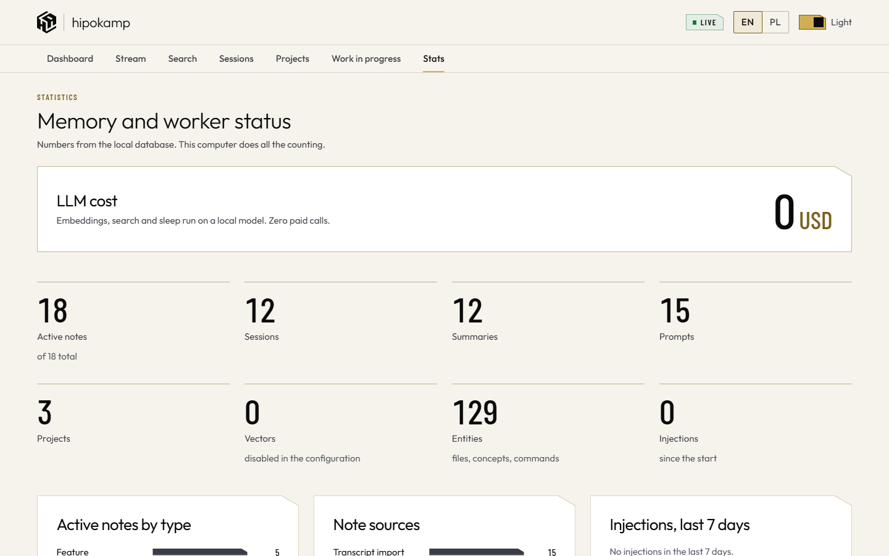

# hipokamp

**English** · [Polski](README.pl.md)

Free, local long-term memory for Claude Code. It also works with Codex, Gemini CLI, Cursor, OpenCode, Claude Desktop and Antigravity (MCP only).

hipokamp turns every turn of your coding sessions into a short note, finds the right notes when you need them and puts them back into the conversation: at session start, on every prompt (only when the match is confident) and when a file is opened. Writing memory needs no language model, so it costs nothing and never stops when a quota runs out. Your memory stays on your machine: no account, no cloud, no telemetry.

It is a drop-in successor to [claude-mem](https://github.com/thedotmack/claude-mem): it imports its database (note numbers stay the same) and exposes MCP tools with the same names and parameters.



## Why

| | claude-mem 13.29 | hipokamp |
|---|---|---|
| Writing a note | an LLM call on every turn | deterministic digest of the transcript, no model, no cost |
| When the model quota runs out | nothing is saved | capture does not depend on any quota |
| Hook latency on Windows | median 1842 ms on PostToolUse ([#3449](https://github.com/thedotmack/claude-mem/issues/3449)) | 29 to 33 ms p50 with the native hook, 155 to 252 ms with the Bun hook |
| Child processes | chroma-mcp, uvx | none, one worker process |
| Search | Chroma (Python) or FTS5 only | SQLite FTS5 with Polish stemming plus local bge-m3 vectors, merged with Reciprocal Rank Fusion |
| Recall | session start, file read | session start, every prompt (confident matches only), file read and edit |
| Telemetry, account | PostHog on by default | none |
| History import | none | `backfill` from `~/.claude/projects` |

Measured on Windows 11 with Bun 1.3.14 in October 2026. Details and methodology are in [docs/ARCHITEKTURA.md](docs/ARCHITEKTURA.md) (Polish).

## Features

- **Capture without an LLM.** Hooks read the session transcript from the last saved offset. Each turn becomes one note: title and narrative from Claude's final answer, facts from tool calls (files, commands, errors, decisions). Secrets are masked before anything is written. The transcript is a durable queue: if a hook is cut off, the worker catches up.
- **Hybrid search.** BM25 plus multilingual vectors computed locally, fused with RRF. No API keys.
- **Recall in three places.** Session start (open work lists, recent sessions, top notes within a 1600 token budget), each prompt (only above a confidence threshold) and file access (with a warning when the file changed after the note).
- **Ranking modelled on human memory.** ACT-R activation, spreading activation over an entity graph, importance, a penalty for injected notes that are never used, MMR under a token budget.
- **Sleep.** When idle, the worker merges near duplicates, proposes replacing older decisions with newer ones on the same topic, archives expired notes and cleans up. No LLM.
- **Work state.** To-do lists per project that show up at the start of every session and in one combined view in the browser.
- **Viewer.** Dashboard, live stream, search, sessions, projects, work lists and statistics in the browser. English and Polish, light and dark.
- **Other agents.** `hipokamp install` connects Codex, Gemini CLI, Cursor, OpenCode, Claude Desktop and Antigravity when they are present (MCP everywhere, session capture where the agent exposes hooks or transcripts).
- **Optional sync** between your own computers through a self-hosted hub that only ever sees ciphertext ([docs/SYNC.md](docs/SYNC.md), Polish).

## Requirements

- [Bun](https://bun.sh) 1.3 or newer.
- Claude Code with plugin support.
- Windows 11: tested in daily use. CI runs on Windows Server (`windows-latest`).
- macOS and Linux: should work (the code handles POSIX paths and permissions), not tested yet.
- Optional: Go 1.25 for the native hook (faster start, built automatically by `hipokamp install` when Go is present). A GPU only speeds up the first vector build.

The vector model (bge-m3) is downloaded once from Hugging Face into `~/.hipokamp/models`: about 600 MB for the default q8 build, plus about 1.1 GB for the fp16 build if you use the GPU path. That is the only network traffic in the default setup.

## Quick start

```bash
git clone https://github.com/lazniak/hipokamp.git
cd hipokamp
bun install
bun link
hipokamp install --dry-run
hipokamp install
hipokamp doctor
```

`bun link` makes the `hipokamp` command available in every terminal. `hipokamp install` registers the plugin (hooks and MCP server) from the local marketplace in this folder, backs up your Claude Code settings and connects the other agents it finds. It takes effect in new sessions.

Coming from claude-mem:

```bash
hipokamp import-claude-mem
hipokamp install --replace-claude-mem
```

The claude-mem database is read only and stays untouched. `hipokamp rollback` switches back at any time.

Import older sessions and compute vectors (optional, the worker also does this in the background):

```bash
hipokamp backfill
hipokamp embed --device cpu --dtype q8
```

On Windows with a GPU, `--device dml --dtype fp16` is much faster.

Update after pulling new commits:

```bash
hipokamp update
```

Keep the plugin in a clean checkout (for example a separate `live` worktree) and write code elsewhere: hooks and the MCP server run the `.ts` files straight from the install folder.

## Viewer

```bash
hipokamp open
```

The worker serves the viewer on http://127.0.0.1:47777 and only on that address. `hipokamp open` opens it with a one time token that the browser exchanges for a cookie, so other local programs cannot read your memory or write to it.

Try it with made up data, without touching your own memory:

```bash
bun run demo
```

| | |
|---|---|
|  |  |
|  |  |

## MCP tools

Same names and parameters as claude-mem, so existing habits, skills and prompts keep working. Results are compact Markdown.

| tool | what it does |
|---|---|
| `search` | index of notes, sessions and prompts with ids, dates, types and token cost |
| `timeline` | what happened around a note or a query |
| `get_observations` | full notes, with a warning when a referenced file changed since |
| `get_tool_uses` | raw tool input and output behind a note |
| `remember` | save a decision, gotcha or preference; a `key` makes newer entries replace older ones |
| `forget` | soft delete with undo |
| `work_state_read`, `work_state_write` | to-do lists and working state shown at session start |
| `session_start_context`, `important_workflow` | context for other clients |
| corpus and `smart_*` tools | named knowledge corpora and code navigation (symbols, outline, unfold) |

Clients without lazy tool loading can use `"mcp": { "tools": "slim" }`: 4 tools instead of 19, about a third of the definition tokens.

## Privacy and security

- Data lives in `~/.hipokamp` (SQLite). Your notes never leave the machine, with two exceptions: the one time download of the vector model from Hugging Face, and optional sync, if you turn it on (it sends only client side encrypted entries to your own hub).
- Secrets are masked before they are stored. Text inside `<private>...</private>` is skipped. Tools listed in `capture.privateTools` (for example a local secrets vault) are never stored.
- The worker listens on 127.0.0.1 only, rejects foreign `Host` and `Origin` headers and requires an HMAC challenge from hooks, the MCP server and the CLI (key in `~/.hipokamp/state/`, readable only by you).
- Hooks never block your work: they always exit with code 0 and have hard time limits.
- Optional local LLM consolidation (Ollama) and webhook notifications are off by default and may only connect to 127.0.0.1.

## Language

The viewer is available in English and Polish. CLI messages, code comments and the detailed documentation in `docs/` are in Polish for now. The full Polish README is [README.pl.md](README.pl.md).

## Development

```bash
bun run lint && bun run typecheck && bun test
```

Tests never touch your real memory or Claude Code settings: every test uses a temporary data folder. Rules for contributors and coding agents: [CLAUDE.md](CLAUDE.md).

## License

MIT, see [LICENSE](LICENSE). © HEXART Sp. z o.o.

Text written with AI assistance.
